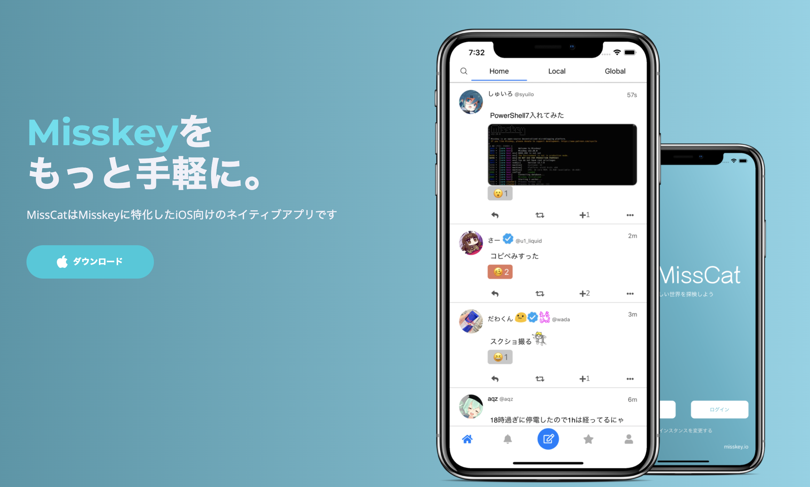

# MissCat

 

 

[公式ページ](https://yuiga.dev/misscat)

MissCatはMisskeyに特化したiOS向けのネイティブアプリです。

  
## Missions & Goals 

MissCatのミッションは以下の<u>5つ</u>です。

- Misskeyをより身近なSNSにすること
- スマホに適した直感的な操作性を提供すること
- インスタンスのバージョン差分を意識しないMisskey環境を提供すること
- iOSらしく分かりやすいデザインを提供すること
- Misskeyを広めること

  
これらに応じて、順に以下のようなゴールを設定しています。
  

- iOSネイティブアプリの提供・通知機能や拡張機能の実装
- スワイプやタップ、半モーダルによる直感的な操作と快適な画面遷移
- めいすきー等のサポート
- 奇抜なデザインを用いない、iOSらしいデザイン設計
- 新規登録画面までの動線

  
## Technical Aspects

### カスタム絵文字

Misskeyにはカスタム絵文字というモノが存在します。

現在のMissCatはSwiftUIの`Text`とネイティブ画像デコーダーで、静止画・GIF・APNGの
カスタム絵文字をインライン表示します。旧`UITextView`/`UIView`基盤、YanagiText、
APNGKit、Gifuには依存していません。

  
### MFM(Misskey Flavored Markdown)

Misskeyでは、独自の構文MFMを用いることで文章の修飾をすることができます。([参照](https://join.misskey.page/ja/wiki/usage/mfm))

MissCatではFoundationでMFMを構文解析し、SwiftUIの`Text`へ直接変換します。
WebViewやUIKitのテキストビューを介さず、リンク、メンション、ハッシュタグ、装飾、
コード、カスタム絵文字を表示します。

  

### 通知
アプリ内の通知一覧は、アカウント単位のMisskey APIとストリームをSwift Concurrencyで
処理します。旧Node/Firebaseリレーと、その認証情報・テスト用トークンは削除しました。
リモートPush通知は現在の移行範囲では明示的に保留しており、将来はFirebaseを前提とせず、
レビュー済みのAPNsアーキテクチャとして別途実装します。

  

### タブ

上タブとページ選択はSwiftUIで実装され、タップと横スワイプが同一の選択状態へ同期します。
旧PolioPagerには依存していません。

  
## Others

- コード汚いです
- 実装していない機能が山程あります
- バグも山程あります

  

MissCatは皆様のご意見をお待ちしております。

[Twitter](https://twitter.com/yuigawada)か[Misskey](https://misskey.io/@wada)にて、ご気軽にリプライ/DMを頂けると幸いです。
